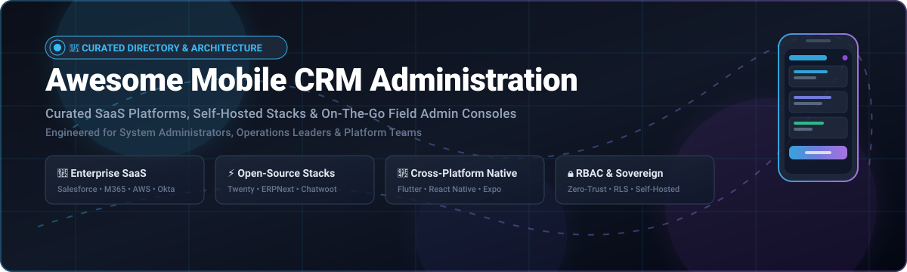

  

  

---

# 📱 Awesome Mobile CRM Administration

> ⚡ **A curated directory and architecture reference of SaaS platforms, open-source projects, and native frameworks for mobile CRM administration, on-the-go configuration, and field operations management.**

Empowering CRM administrators, IT operations managers, site reliability engineers, and field supervisors to configure permissions, monitor system telemetry, resolve escalated tickets, provision users, and audit security policies directly from mobile devices—untethered from desktop command centers.

---

## 📑 Table of Contents

- [🔍 SEO & Architecture Overview](#-seo--architecture-overview)
- [📊 Sector Overview & Market Dynamics](#-sector-overview--market-dynamics)
- [🏢 SaaS & Hosted Enterprise Admin Consoles](#-saas--hosted-enterprise-admin-consoles)
- [⚡ Open-Source GitHub Projects](#-open-source-github-projects)
- [🛠️ Architectural Blueprints & Stacks](#️-architectural-blueprints--stacks)
- [🤝 How to Contribute](#-how-to-contribute)
- [⭐ Star History](#-star-history)
- [📜 License & Disclaimer](#-license--disclaimer)

---

## 🔍 SEO & Architecture Overview

| Key Topic | Description & Metadata Focus |
| :--- | :--- |
| **Target Audience** | CRM Administrators, IT Helpdesk Leads, SysAdmins, DevOps, Field Operations Managers |
| **Primary Categories** | Mobile CRM, Field Service Administration, Self-Hosted CRM, Mobile Admin Console, Identity Governance |
| **Core Capabilities** | User Lifecycle Management, Role-Based Access Control (RBAC), Push Alerts, Incident Triage, Remote Wipe |
| **Frameworks** | Flutter, React Native, Expo, Tailwind CSS, REST / GraphQL APIs, PostgreSQL RLS |

---

## 📊 Sector Overview & Market Dynamics

The global **Mobile CRM and Field Administration Software** market was valued at approximately **$22.4 billion in 2024** and is projected to expand to **$48.5 billion by 2030**, exhibiting a compound annual growth rate (**CAGR**) of **13.7%**. This explosive acceleration is propelled by remote-first enterprise workforces, real-time field service coordination, and the proliferation of mission-critical cloud infrastructure demanding instant incident intervention.

The market displays a **bifurcated competitive structure**:
- **Highly to Moderately Concentrated at the Enterprise Core**: Hyper-scale ecosystem incumbents (**Microsoft, Alphabet, Amazon AWS, Salesforce, ServiceNow**) capture dominant enterprise market share through integrated enterprise suites and unified identity systems.
- **Moderately Fragmented at the Edge & Mid-Market**: Rapidly diversifying across vertical SaaS providers and self-hosted open-source software (**Twenty, ERPNext, ToolJet, Chatwoot**), driven by demand for data sovereignty, custom role-based workflows, and freedom from high per-seat licensing costs.

---

## 🏢 SaaS & Hosted Enterprise Admin Consoles

*Sorted in descending order by parent company scale (revenue / market valuation).*

| 📱 Platform | 🎯 Key Capabilities & Admin Focus | 📈 Company Scale (Revenue / Valuation) | 💵 Starting Pricing | 🎁 Free Tier / Trial Limit |
| :--- | :--- | :--- | :--- | :--- |
| **[Microsoft 365 Admin App](https://www.microsoft.com/en-us/microsoft-365/business)** | Manage licenses, users, and security groups; monitor Microsoft 365 service health, view audit logs, reset passcodes, and receive real-time outage alerts. | **~$3.1T Valuation** *(~$245B Annual Revenue)* | **$6.00 / user / month** *(Business Basic tier, annual commitment)* | **30-Day Free Trial** *(Full access with up to 25 user licenses)* |
| **[Google Workspace Admin App](https://workspace.google.com/)** | Administrative mobile console for Google Workspace; configure user accounts, enforce 2-step verification, audit security logs, and wipe remote mobile devices. | **~$2.2T Valuation** *(~$350B Alphabet Revenue)* | **$6.00 / user / month** *(Business Starter plan, 1-year contract)* | **14-Day Free Trial** *(Complete suite access supporting up to 10 users)* |
| **[AWS Console App](https://aws.amazon.com/console/)** | Triage CloudWatch alarms, restart EC2 instances, manage RDS databases, view billing thresholds, and execute operational scripts on mobile. | **~$2.0T Valuation** *(~$105B AWS Revenue)* | **$0.00 Base** *(Pay-as-you-go; e.g., EC2 t4g.nano from $0.0042/hr)* | **AWS Free Tier (12 Months)** *(750 hrs/mo t2/t3.micro, 5GB S3, plus always-free 1M Lambda req/mo)* |
| **[Salesforce SalesforceA for Admins](https://www.salesforce.com/)** | Dedicated mobile app for Salesforce administrators; instantly freeze accounts, unlock locked users, reset passwords, assign permission sets, and review org releases. | **~$280B Valuation** *(~$35B Annual Revenue)* | **$25.00 / user / month** *(Salesforce Starter Suite, billed annually)* | **30-Day Free Trial** *(Pre-configured Starter Suite instance with sample data)* |
| **[Cisco Meraki Mobile Admin](https://meraki.cisco.com/)** | Manage cloud-controlled access points, switches, security cameras, and mobile endpoints (MDM); live port troubleshooting, AP health telemetry, and push alerts. | **~$230B Valuation** *(~$54B Cisco Revenue)* | **~$150.00 / device / year** *(Enterprise Cloud License for network hardware)* | **14-Day Free Evaluation** *(Full hardware loan program with cloud management dashboard)* |
| **[ServiceNow Admin App](https://www.servicenow.com/)** | Enterprise IT service management on iOS/Android; route incidents, execute change approvals, manage user roles, and monitor critical service health on the fly. | **~$185B Valuation** *(~$10B Annual Revenue)* | **~$100.00 / user / month** *(ITSM Pro tier, annual enterprise contract)* | **Forever-Free PDI** *(Personal Developer Instance with full admin privileges, active with 10-day logins)* |
| **[Okta Admin App](https://www.okta.com/)** | Mobile identity governance; approve push authentications, reset user MFA tokens, provision/suspend users, and respond to directory security breaches. | **~$16B Valuation** *(~$2.5B Annual Revenue)* | **$2.00 / user / month** *(Single Sign-On plan, $1,500/year minimum spend)* | **30-Day Free Trial** *(Up to 100 users across Workforce Identity Cloud)* |
| **[Zendesk Support Mobile](https://www.zendesk.com/)** | Customer support queue administration; monitor agent ticket response velocity, update triggers/macros, assign escalations, and manage SLA timers from anywhere. | **$10.2B Valuation** *(~$1.7B Annual Revenue)* | **$19.00 / agent / month** *(Support Team plan, billed annually)* | **14-Day Free Trial** *(Full Zendesk Suite Professional features with multi-channel support)* |
| **[Freshdesk Mobile Admin](https://www.freshworks.com/freshdesk/)** | Omnichannel ticketing and field service administration; assign tickets, manage agent availability status, track customer SLA resolutions, and trigger canned actions. | **~$4.5B Valuation** *(~$700M Annual Revenue)* | **$15.00 / agent / month** *(Growth plan, billed annually)* | **Free Forever Plan** *(Up to 10 agents with ticket tracking, knowledge base, & mobile app)* |
| **[Jamf Admin / Jamf Now](https://www.jamf.com/)** | Apple MDM configuration console for iOS/macOS; zero-touch deployment blueprints, device inventory, remote passcode locks, and app distribution. | **~$2.0B Valuation** *(~$600M Annual Revenue)* | **$4.00 / device / month** *(Jamf Now plan, billed monthly)* | **Free Forever Plan** *(First 3 managed devices completely free forever)* |

---

## ⚡ Open-Source GitHub Projects

*Sorted in descending order by GitHub repository star counts. Star badges link directly to the repository's stargazers page.*

- **[Strapi](https://github.com/strapi/strapi)**   
  Leading open-source headless CMS and API admin backend with granular role-based access control (RBAC), responsive administrative console, and auto-generated REST/GraphQL endpoints for mobile clients.

- **[NocoDB](https://github.com/nocodb/nocodb)**   
  Open-source Airtable alternative that transforms any PostgreSQL, MySQL, or SQL Server into a powerful smart CRM and relational database console, featuring mobile-responsive web views and instant REST APIs.

- **[Twenty CRM](https://github.com/twentyhq/twenty)**   
  Modern open-source CRM built with TypeScript, React, and GraphQL. Provides an enterprise-grade modular alternative to Salesforce with clean administrative permissions, custom entity schemas, and mobile-friendly layouts.

- **[Appwrite](https://github.com/appwrite/appwrite)**   
  Self-hosted backend-as-a-service (BaaS) providing an intuitive administrative console to configure mobile authentication, user roles, SQLite/MariaDB databases, push notifications, and storage bucket security.

- **[ToolJet](https://github.com/ToolJet/ToolJet)**   
  Open-source low-code platform for building bespoke internal mobile admin consoles, CRM management dashboards, and operational tools connecting directly to PostgreSQL, MongoDB, Stripe, and REST endpoints.

- **[ERPNext](https://github.com/frappe/erpnext)**   
  Comprehensive open-source ERP & CRM platform featuring official Flutter mobile apps for Android and iOS. Includes end-to-end sales lead pipeline, customer management, inventory admin, and custom role workflows.

- **[Chatwoot](https://github.com/chatwoot/chatwoot)**   
  Open-source customer engagement suite and CRM helpdesk with official native Flutter mobile apps (iOS & Android). Allows administrators and agents to manage live conversations, assign leads, and monitor team activity on mobile.

- **[Budibase](https://github.com/Budibase/budibase)**   
  Open-source low-code builder tailored for IT teams and DevOps to assemble responsive mobile admin portals, CRM customer directories, approval workflows, and role-based forms in minutes.

- **[SuiteCRM](https://github.com/SuiteCRM/SuiteCRM)**   
  Enterprise open-source CRM alternative to Salesforce with REST/GraphQL APIs, community mobile companion apps, and deep administrative control over accounts, contacts, and security groups.

- **[FreeScout](https://github.com/freescout-help-desk/freescout)**   
  Lightweight open-source helpdesk and shared mailbox built on PHP/Laravel, offering cross-platform mobile apps for Android and iOS. Lets administrators triage support tickets, manage user access, and oversee mailboxes.

- **[EspoCRM](https://github.com/espocrm/espocrm)**   
  Fast open-source CRM with native mobile app support for iOS and Android. Administrators can manage pipelines, configure layouts, monitor security roles, and synchronize lead activities in real time.

- **[BottleCRM](https://github.com/Django-CRM/Django-CRM)**   
  Open-source multi-tenant CRM built with Django, PostgreSQL Row-Level Security (RLS), and a native Flutter mobile app for iOS and Android, purpose-built for mobile operational management and ticket administration.

- **[Kubenav](https://github.com/kubenav/kubenav)**   
  Mobile cluster navigation and operations app for Kubernetes. Built with Flutter and Go for iOS and Android, allowing admins to inspect pods, scale deployments, tail container logs, and resolve cluster alerts on the go.

- **[Faveo Helpdesk](https://github.com/faveosuite/faveo-helpdesk)**   
  Open-source helpdesk and customer ticketing system powered by Laravel, with dedicated Community Edition mobile apps for Android and iOS to administer support tickets and agents.

- **[sub2api-mobile](https://github.com/ckken/sub2api-mobile)**   
  Mobile-first administrative console built with React Native and Expo for managing server health, multi-account routing, and API key governance.

- **[K8Z](https://github.com/k8zdev/k8z)**   
  Lightweight mobile application for Kubernetes management on iOS and Android. Provides real-time cluster metrics, container shell access, and workload monitoring.

- **[Pi-hole Client](https://github.com/tsutsu3/pi-hole-client)**   
  Open-source Android client for Pi-hole DNS server administration. Enables/disables blocking, domain whitelist/blacklist adjustments, and real-time query log inspection.

- **[Pi Stats Mobile](https://github.com/Bunn/PiStatsMobile)**   
  Open-source iOS application to monitor network statistics, query volumes, and administrative status across multiple Pi-hole servers.

- **[CustomerDB-Android](https://github.com/schorschii/CustomerDB-Android)**   
  Privacy-first Android application for managing customer accounts, contact history, and appointments without forced cloud connectivity or third-party tracking.

- **[pfDroid](https://github.com/CharlieMarshall/pfDroid)**   
  Open-source Android utility to monitor and configure pfSense firewalls, inspect gateway statuses, and review network filter alerts.

- **[Demo-MultiRoleApp](https://github.com/coderooz/Demo-MultiRoleApp)**   
  Reference implementation using React Native and Expo showcasing role-based user navigation (Admin, Editor, Viewer) for mobile enterprise console architectures.

---

## 🛠️ Architectural Blueprints & Stacks

When engineering a custom sovereign mobile CRM administration platform:

1. **Backend & Data Sovereignty Layer**:
   - **[Twenty CRM](https://github.com/twentyhq/twenty)** or **[EspoCRM](https://github.com/espocrm/espocrm)** for core customer data models and REST/GraphQL APIs.
   - **[Appwrite](https://github.com/appwrite/appwrite)** or **Supabase** for secure auth, storage, and real-time WebSocket syncing.
2. **Support & Operations Bridge**:
   - **[Chatwoot](https://github.com/chatwoot/chatwoot)** or **[FreeScout](https://github.com/freescout-help-desk/freescout)** for mobile support ticket management and live customer routing.
3. **Cross-Platform Mobile UI**:
   - **[Flutter](https://flutter.dev/)** or **[React Native + Expo](https://reactnative.dev/)** for performant native rendering across iOS and Android.
4. **Security & Identity Governance**:
   - Role-Based Access Control (**RBAC**), Zero-Trust principles, biometric authentication (FaceID / Fingerprint), and short-lived JWT tokens for mobile sessions.

---

## 🤝 How to Contribute

Contributions are highly appreciated! Help keep this ecosystem comprehensive, accurate, and up-to-date:

1. 🍴 **Fork** this repository.
2. 🌿 Create a feature branch: `git checkout -b feature/add-new-tool`.
3. 📝 Update `README.md` following the established table / list format:
   - Provide verified pricing and exact free trial / free tier terms for SaaS entries.
   - Provide repository links and appropriate star badges for open-source entries.
4. 🚀 Commit your improvements: `git commit -m "Add <Tool-Name> to mobile CRM ecosystem"`.
5. 📤 Push to your fork and submit a **Pull Request**.

---

## ⭐ Star History

---

## 📜 License & Disclaimer

- **License**: Released under the [MIT License](LICENSE).
- **Disclaimer**: This curated list is maintained for architectural, educational, and operational reference only. Product trademarks and brand names are property of their respective owners. Self-hosted administrative tools should always be protected with proper network firewalls, VPNs, and mobile security hardening.

---

  <b>Built with ❤️ for CRM Administrators, IT Leaders, and Mobile Platform Engineers.</b>

